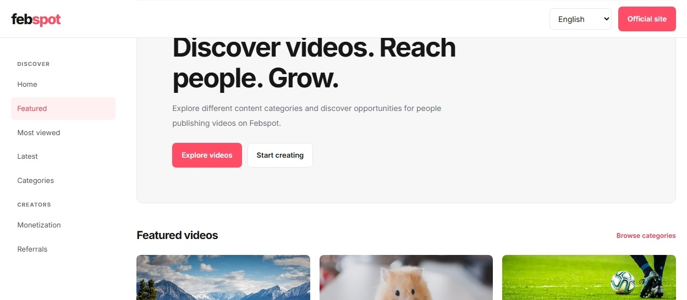

# Febspot Inspired UI

Frontend prototype inspired by the Febspot platform.

---

## Features

* Responsive design
* Multi-language support
* Video search
* Category filtering
* Modern UI

---

## Technologies

* HTML5
* CSS3
* JavaScript

---

## Live Demo

* [https://mpasprime.github.io/febspot-inspired-ui/](https://mpasprime.github.io/febspot-inspired-ui/)

---

## Disclaimer

> This is an educational project created for learning and portfolio purposes.
> 
> It is not affiliated with, endorsed by, or maintained by Febspot.
